# atc

**Run all your Claude Code sessions from one place, and from your phone.** See which one is stuck, answer
it from anywhere, talk to them by voice, and hand recurring jobs to agents that wake up on their own.

atc runs on your own machines, on your own Claude Code sign-in. Sessions keep running when you close the
tab, lose the connection or restart atc.

<picture>
  <source media="(prefers-color-scheme: dark)" srcset="docs/img/hero-dark.webp">
  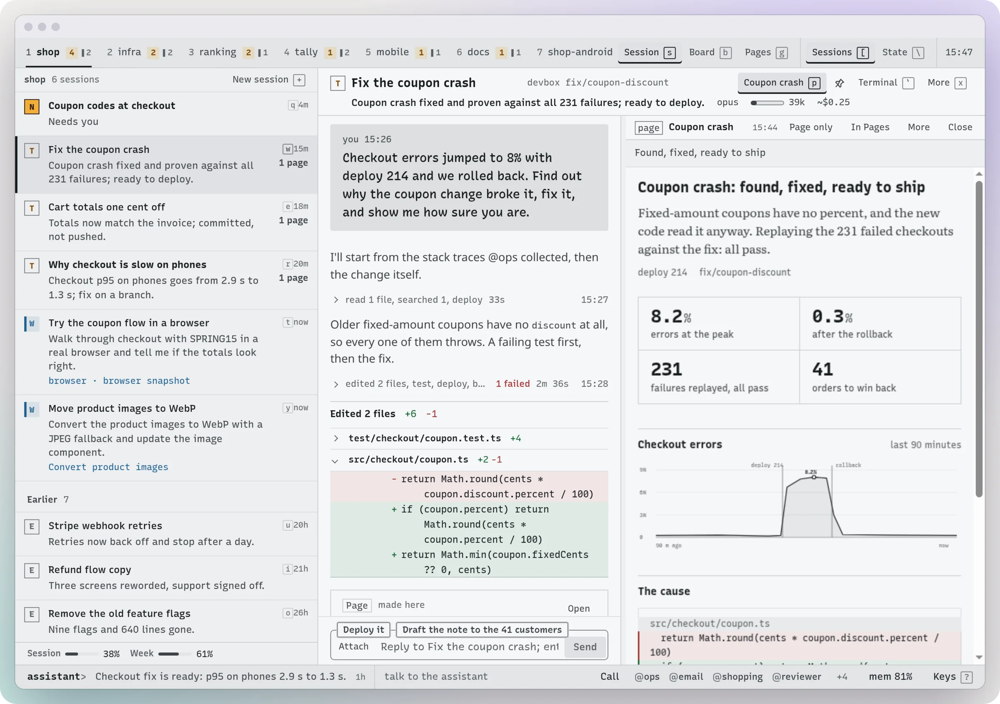
</picture>

```sh
curl -fsSL https://github.com/zcag/atc/releases/latest/download/install.sh | sh
```

Linux or macOS, with Claude Code signed in. One install serves one user. [More ways to install](#install).

atc is an independent project. It is not affiliated with or endorsed by Anthropic.

## Never miss the session that's stuck

With a few sessions running, one is always waiting on a permission prompt in a tab you aren't looking at.
atc puts every session from every machine in one list, with what's waiting on you at the top. Each row says
what the session did in a line, so most of the time you don't have to open it.

<picture>
  <source media="(prefers-color-scheme: dark)" srcset="docs/img/board-dark.webp">
  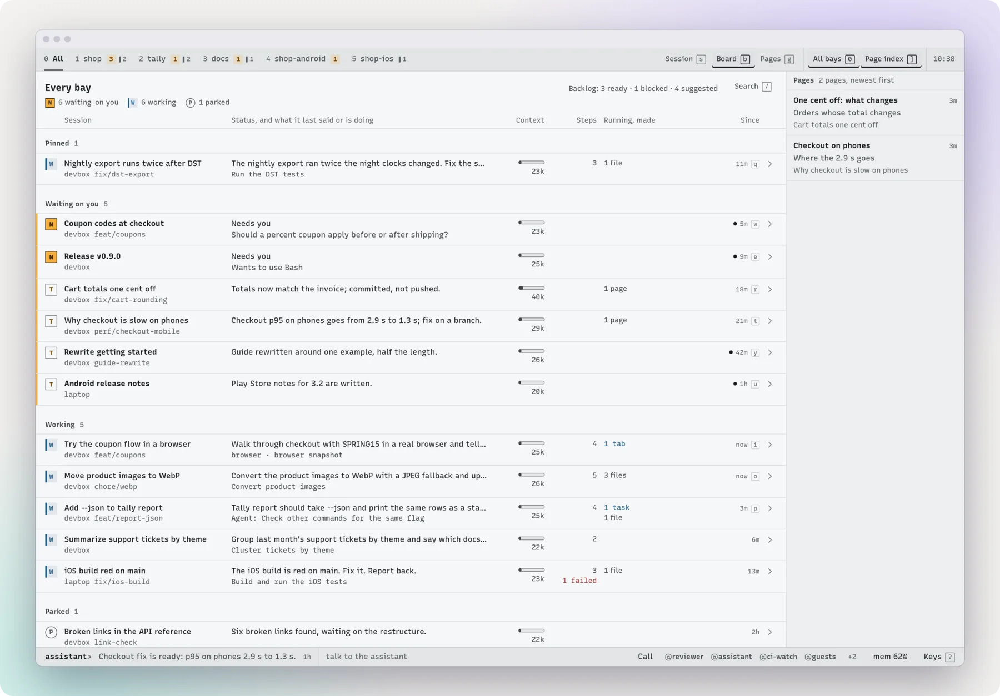
</picture>

[Using atc](docs/using.md) · [Several machines](docs/machines.md)

## Keep them moving from your phone

Step away and your sessions no longer sit there waiting for you. You get a push when one needs you, and you can
approve or answer from the notification. Read what it did, reply, start something new, or share a link or
screenshot from any app into a session. Holding the side key opens what's waiting, even on the lock screen.

<picture>
  <source media="(prefers-color-scheme: dark)" srcset="docs/img/phones-dark.webp">
  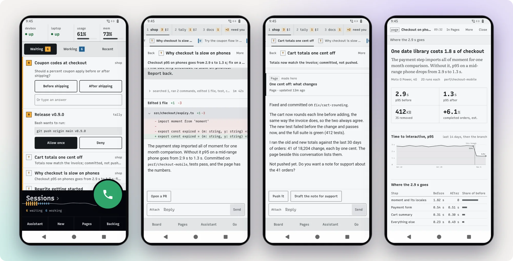
</picture>

Android app. On other devices, atc works in the browser. [Android app](docs/android.md)

## Talk to them while you're out

Your hands are busy and you want to know how things are going: call. The assistant knows what every session is
doing, tells you what needs you, and passes your answer on. It works the other way too: a session that
needs a decision can ring your phone, and when you pick up, the assistant says why and takes your answer back.

<picture>
  <source media="(prefers-color-scheme: dark)" srcset="docs/img/call-dark.webp">
  
</picture>

Runs on your own machine on 2 CPU cores. No phone number needed; the app and the browser can both call. [Calls](docs/calls.md)

## Say what you want, not which session

Instead of finding the right tab, tell one assistant: "find out why checkout is slow and fix the build on the
laptop." It starts the sessions, follows them, and tells you what came of it. Type to it, call it or message it
on WhatsApp, and it's the same conversation.

<picture>
  <source media="(prefers-color-scheme: dark)" srcset="docs/img/assistant-dark.webp">
  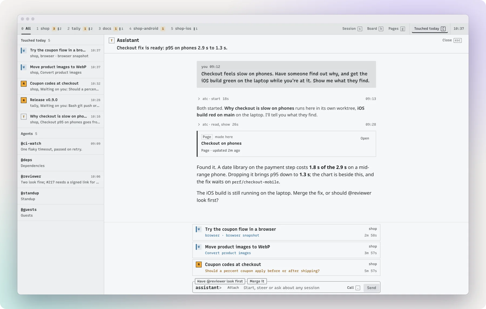
</picture>

[The assistant](docs/assistant.md) · [Sessions driving sessions](docs/sessions.md) · [WhatsApp](docs/whatsapp.md)

## Hand off the jobs that keep coming back

Reviewing new pull requests, looking into a failed CI run, sorting your mail. Give a job a folder with its
instructions and it becomes an agent: it wakes on a schedule, when a check finds something, or when an alert
posts to it. It remembers earlier runs, works out of sight, and only comes to you when it has something for you.
What it knows stays on a page you can open any time.

<picture>
  <source media="(prefers-color-scheme: dark)" srcset="docs/img/agents-dark.webp">
  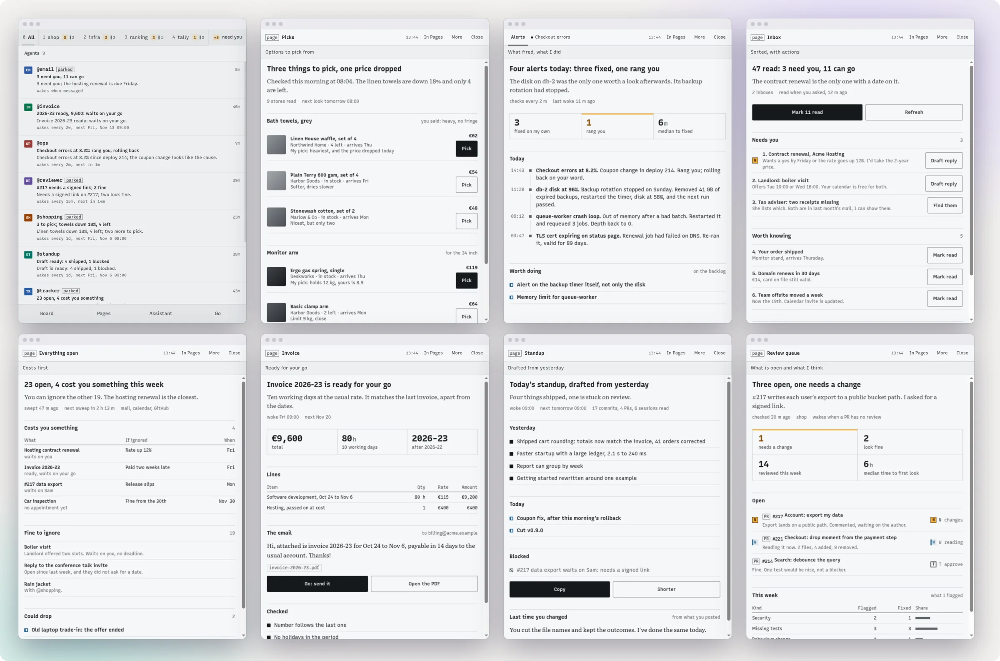
</picture>

[Presets and agents](docs/presets-and-agents.md)

## Catch up without the scrollback

Come back to a session after an hour and read what it did, not hundreds of lines of terminal: your request,
its answer, and a short account of the work in between, with the diffs, test results and commits. Search the
whole session, or jump to just the failures. Likely replies are one tap away.

<picture>
  <source media="(prefers-color-scheme: dark)" srcset="docs/img/transcript-dark.webp">
  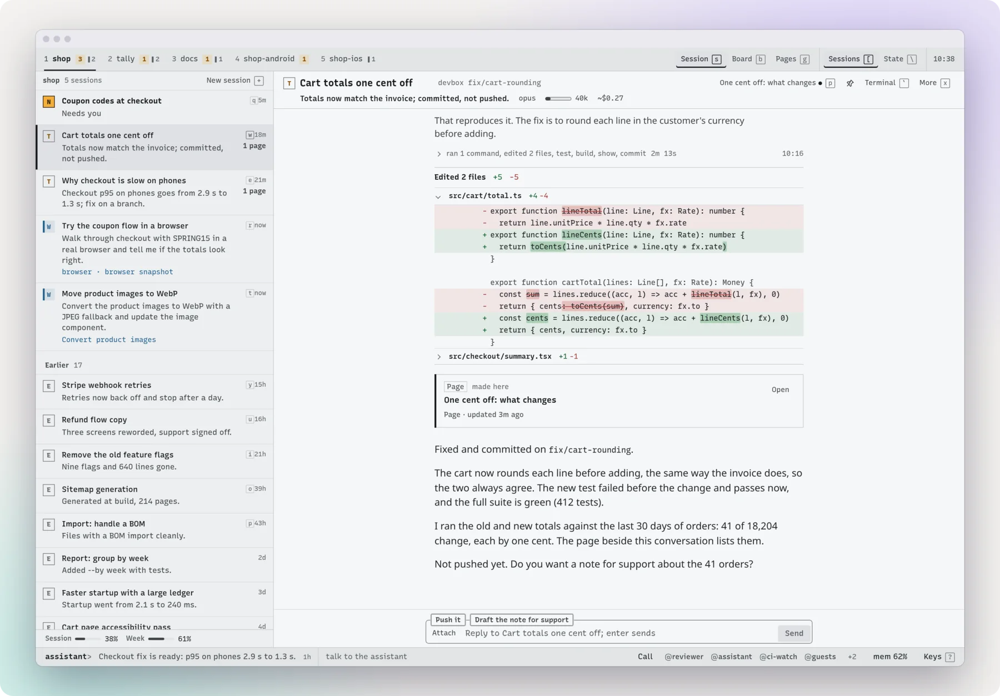
</picture>

## Get a report, not a wall of text

When there's something to look at, a session makes a page and it opens beside the conversation: a report with
charts, a comparison, an inbox with buttons that act on it. It updates as the session works, and every page from
every session is there on your phone too.

<picture>
  <source media="(prefers-color-scheme: dark)" srcset="docs/img/pages-dark.webp">
  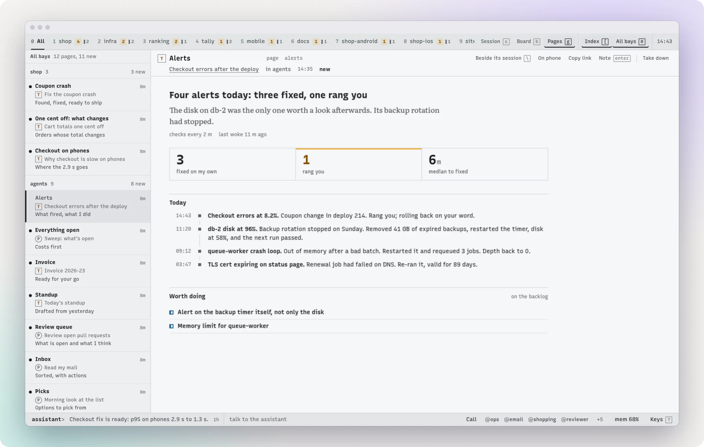
</picture>

[Pages](docs/pages.md)

## Step in when a website needs you

A session driving a browser stops dead at a login, a 2FA code or a captcha. In atc, you see its tab live beside
the conversation, so you click and type what it needs and let it carry on, from your phone if you like. Sessions
share one browser's logins, and each sees only its own tabs.

<picture>
  <source media="(prefers-color-scheme: dark)" srcset="docs/img/browser-dark.webp">
  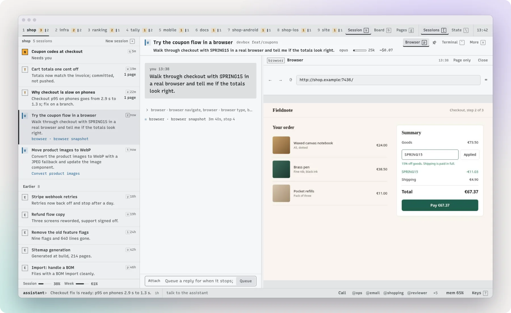
</picture>

[A browser for sessions](docs/browser.md)

## Don't run out halfway through the week

See how fast you're using your plan and when you'd hit the limit at this pace, what each project and session
spent, and what's eating your machine: memory and CPU per session, including the dev server a finished session left
behind.

<table>
<tr>
<td width="50%"><picture>
  <source media="(prefers-color-scheme: dark)" srcset="docs/img/usage-dark.webp">
  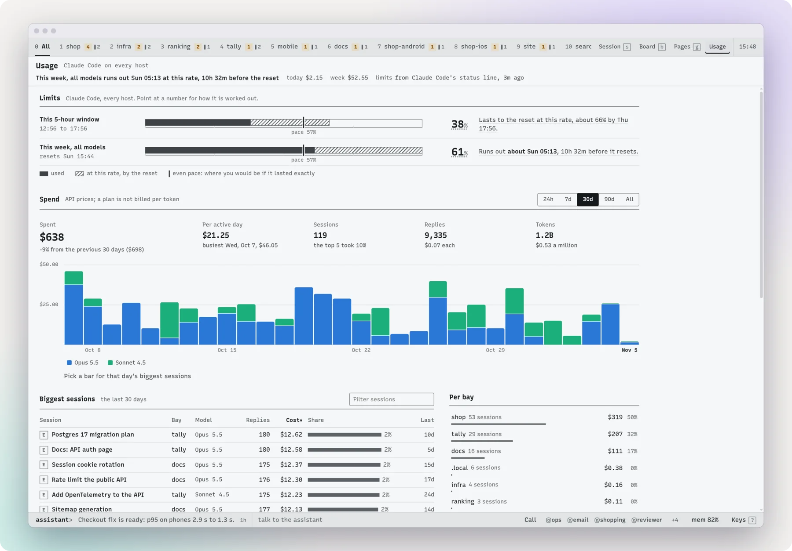
</picture><br></td>
<td width="50%"><picture>
  <source media="(prefers-color-scheme: dark)" srcset="docs/img/resources-dark.webp">
  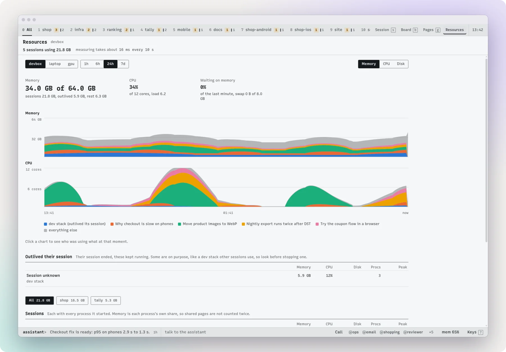
</picture><br></td>
</tr>
</table>

[Usage and limits](docs/usage.md) · [Resources](docs/resources.md)

## And the rest

<table>
<tr>
<td width="50%"><picture>
  <source media="(prefers-color-scheme: dark)" srcset="docs/img/new-dark.webp">
  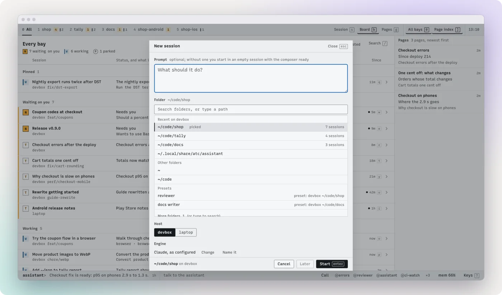
</picture><br><b>Start work on any machine, from anywhere.</b> Any folder, in its own worktree so sessions don't collide, on Claude or <a href="docs/models.md">a local model</a>.</td>
<td width="50%"><picture>
  <source media="(prefers-color-scheme: dark)" srcset="docs/img/backlog-dark.webp">
  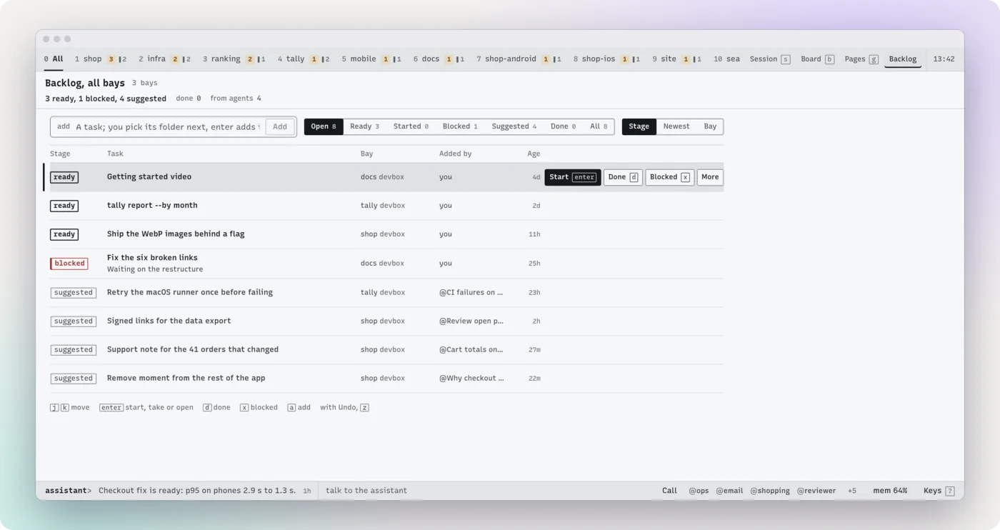
</picture><br><b>Save it for later.</b> Note a task without starting it, or set a session aside and pick it up where it was. <a href="docs/backlog-and-notify.md">Backlog</a></td>
</tr>
<tr>
<td width="50%"><picture>
  <source media="(prefers-color-scheme: dark)" srcset="docs/img/terminal-dark.webp">
  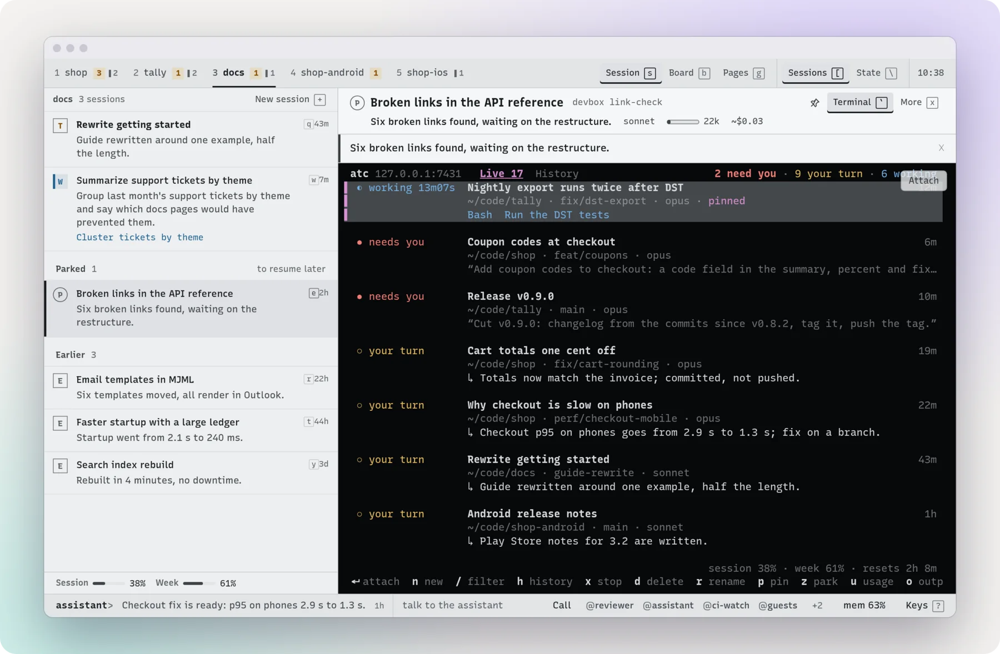
</picture><br><b>Keep your terminal.</b> <code>atc</code> is the same list as a terminal UI, and <code>atc attach</code> opens any session from any computer. <a href="docs/using.md#from-a-terminal">From a terminal</a></td>
<td width="50%"><picture>
  <source media="(prefers-color-scheme: dark)" srcset="docs/img/palette-dark.webp">
  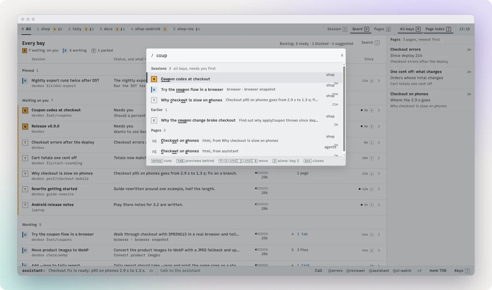
</picture><br><b>Get anywhere by keyboard.</b> Find any session or page in a few letters, and there's a key for everything else.</td>
</tr>
<tr>
<td width="50%"><picture>
  <source media="(prefers-color-scheme: dark)" srcset="docs/img/settings-dark.webp">
  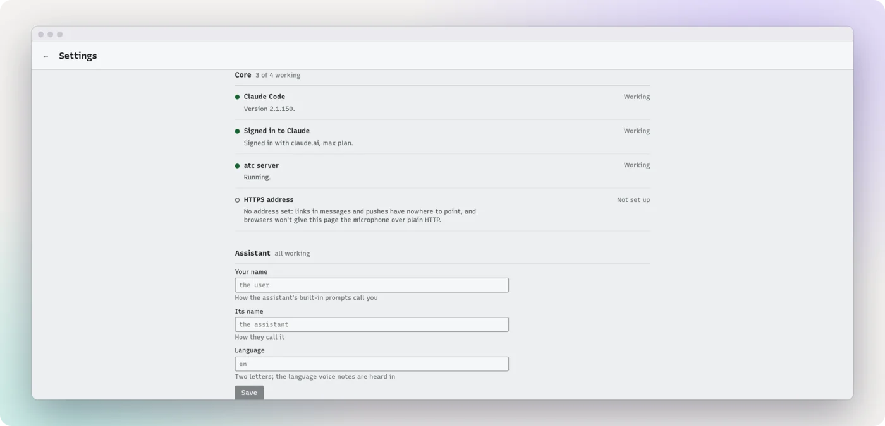
</picture><br><b>No guessing what's set up.</b> Settings and <code>atc doctor</code> check every feature for real and give you the fix. <a href="docs/settings.md">Settings and doctor</a></td>
<td width="50%">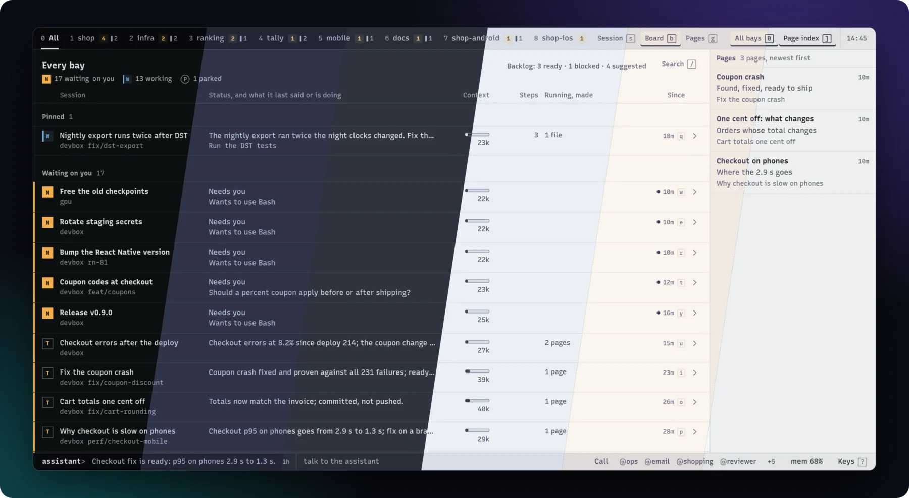<br><b>Make it yours.</b> Light and dark, three themes, <a href="docs/look.md">one file to add another</a>.</td>
</tr>
</table>

Every image here comes from atc running on made-up sessions (`test/demo/`), with its real UI, on a fake Claude and a
scripted call line. The figures on the Resources screen are made up too. The window and phone frames are drawn around the
screenshots, and the phones are the page at phone width, not the Android app.

## How it works with Claude Code

atc needs Claude Code installed and your own sign-in to it, on the machine atc runs on. It brings no
account and no key of its own.

- It runs the unmodified `claude` binary as the signed-in user: `claude --bg`, `claude attach`,
  `claude agents`, and `claude -p` for summaries.
- It reads what Claude Code keeps on disk for that user: conversation transcripts, its list of
  background sessions.
- It reads your plan limits from Claude Code's status line. `atc setup` sets that up
  (`atc limits -tap`), or tells you the line to add if you have your own status line.
- It changes Claude Code's own files in two places: `atc setup`, when you say yes, sets the status
  line and adds atc's MCP server; and atc lists its live sessions in `jobs/pins.json`, which keeps
  Claude Code's background service from retiring them.
- It does not proxy Claude's traffic, modify the `claude` binary, or send your sessions anywhere but
  the devices you connect. By default it does not read Claude Code's stored credentials.

Everything sessions spend comes out of your own plan or API key, under your agreement with Anthropic.

## Install

```sh
curl -fsSL https://github.com/zcag/atc/releases/latest/download/install.sh | sh
```

This downloads a release for Linux or macOS, checks its checksum, installs `atc` into `~/.local/bin`,
runs it and the assistant as services of your user, and starts `atc setup`.

Or build from source (Go 1.26 or newer):

```sh
go install github.com/zcag/atc@latest
atc service install
```

Then:

1. `atc setup` asks who you are, sets the status line for plan limits, adds atc's tools for your
   sessions and says how to reach atc from other devices. It prints a link to open.
2. `atc doctor` lists what each feature needs, how it stands and the fix.
3. **Settings** in the page (`,`) shows the same list, with a field for each setting.

More in [Install](docs/install.md) and [Security](docs/security.md).

## What you need for what

The core and the assistant work right after install. The rest is optional.

| | What you get | What it takes |
|---|---|---|
| **Core** | The session list, transcripts, pages, agents, backlog, usage, one-line summaries of finished turns | Claude Code. The summaries use a little of your plan; they can use your own model or be off |
| **Assistant** | One conversation that runs the others | On by default, a small second service |
| **Calls** | Talk to it from the browser or the app | `atc voice install`: about 2 GB on disk, 2 CPU cores |
| **WhatsApp and a phone number** | Reach it from WhatsApp or a real number, and let a few other people reach it | Advanced: accounts and numbers of their own, and no promises |

## Docs

[Install](docs/install.md) ·
[Settings and doctor](docs/settings.md) ·
[Security](docs/security.md) ·
[Using atc](docs/using.md) ·
[Several machines](docs/machines.md) ·
[Android app](docs/android.md) ·
[Presets and agents](docs/presets-and-agents.md) ·
[Other models and opencode](docs/models.md) ·
[Pages](docs/pages.md) ·
[Backlog and notify](docs/backlog-and-notify.md) ·
[A browser for sessions](docs/browser.md) ·
[Outputs](docs/outputs.md) ·
[Summaries](docs/summaries.md) ·
[Usage and limits](docs/usage.md) ·
[Resources](docs/resources.md) ·
[Sessions driving sessions](docs/sessions.md) ·
[The assistant and its channels](docs/assistant.md) ·
[Calls](docs/calls.md) ·
[WhatsApp and speech services](docs/whatsapp.md) ·
[Look and themes](docs/look.md)

## License

MIT, see [LICENSE](LICENSE). What atc bundles and depends on is listed in
[THIRD_PARTY.md](THIRD_PARTY.md).
