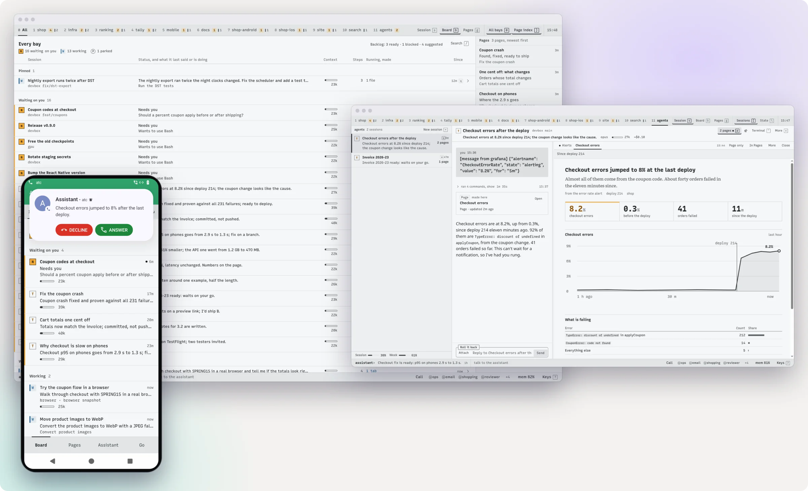
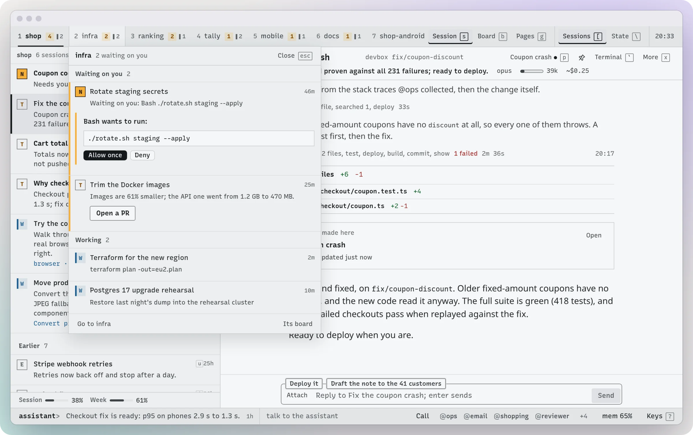

# atc

**A control center for Claude Code across all your machines.** Sessions see and direct each other, and an assistant you talk to like a
person on the phone keeps track of it all and calls you when something can't wait.

Past a few parallel sessions, the hard part stops being the work. Which one is waiting on you? What did that one do while you were away?
Which machine was it on? Ask out loud, or see it at a glance on atc's board, at your desk and on your phone. Agents look after
things like your mail, alerts and invoices. It all runs on your own machines, on your own Claude plan.


*A recorded call on the real call stack, with the transcript and notes beside the phone. The incident and Claude's lines are written for the demo. [Watch it with sound](#an-assistant-you-talk-to-on-the-phone).*

- **[An assistant you talk to on the phone](#an-assistant-you-talk-to-on-the-phone).** A natural conversation that can run your sessions, your agents and whatever else you connect it to.
- **[Control of every session](#control-of-every-session).** Dozens running on several machines, and you still know what each one needs and did, from any screen.
- **[Sessions that run other sessions](#sessions-that-run-other-sessions).** They start, ask and hand work to each other, and you can step into any of them.
- **[Agents for your own stuff](#agents-for-your-own-stuff).** Standing specialists that wake up when there's work and remember what they've learned.
- **[A bay for each project](#a-bay-for-each-project).** Switch projects with one key and land where you left off.
- **[Pages instead of walls of text](#pages-instead-of-walls-of-text).** A session hands you a live report, chart or inbox with working buttons.

```sh
curl -fsSL https://github.com/zcag/atc/releases/latest/download/install.sh | sh
```

Linux or macOS, with Claude Code signed in. One install serves one user. [More on installing](#install). Calls are one more command,
`atc voice install` (about 2 GB on disk, 2 CPU cores; Linux for now, macOS is coming). [Calls](docs/calls.md)

**Keep atc off the public internet.** A login to atc is a shell on your machine. Out of the box it answers that machine, your local
network and your tailnet, and refuses public addresses. [Reach it from other devices](docs/install.md#reach-it-from-other-devices)

atc is an independent project. It is not affiliated with or endorsed by Anthropic.

## An assistant you talk to on the phone

Call it from the app or a browser, with no phone number needed, or let anything that can't wait ring you. The assistant is one long
conversation, shared with the atc page and WhatsApp, and it already knows the state of every session and machine when you say hello.

https://github.com/user-attachments/assets/9466a58a-2f55-47ca-9010-11f6ca12b784

**What you can get done on a call**

- **Ask how things stand** and hear the answer right away, from what it already knows.
- **Start and steer work.** Start a session on any machine, or tell a running one what to do, in your own words. Say yes to a merge, push or deploy and the session goes ahead without asking you again. Anything long runs on after you hang up, and you hear how it came out.
- **Talk to a specialist.** Say "put @ops on" and the line moves to that agent (any you have allowed to talk), which knows what you just said. Say "back to the assistant" to return, even in the middle of its work.
- **See things.** It says the gist and puts the page or chart on your phone's screen while you keep talking.
- **Reach past atc.** It is a Claude Code conversation on your machine, so it has your command-line tools, scripts and MCP servers. Whatever you've connected them to (mail, calendar, your home) is one sentence away. It reads back and waits for a clear yes before sending, buying or deleting anything.

The one thing it can't do is answer a session's permission prompt. Those still take a tap.

**Why it feels like talking to someone**

- **Cut it off any time.** It stops at once and knows exactly how much of its answer you heard.
- **Say "mhm" or "right" while it talks.** It carries on, because those words don't count as interrupting.
- **Pause to think.** A model listens for whether your turn sounds finished, and a sentence left hanging on "and..." keeps the turn open.
- **No dead air.** It says a short thinking phrase while it starts, and tells you what it's doing and what it has found so far as it goes.
- **It talks the way people do on the phone.** Short sentences, rounded numbers, no paths or ids read aloud. If a session needs you mid-call, it judges whether that's worth interrupting you for.
- **Switch language mid-call.** With more than one installed, the voice, the transcriber and the character all change with you.

<picture>
  <source media="(prefers-color-scheme: dark)" srcset="docs/img/call-ring-dark.webp">
  
</picture>

*The three built-in characters: one ringing, one speaking, one listening. On Android it is a real phone call: it rings on the lock screen and appears in your call log, you answer from Bluetooth or car buttons, it works on Android Auto, and it goes on hold for a SIM call.*

It runs on your machine on 2 CPU cores: about 3 seconds from when you stop talking to its first word, most of that Claude's first
token. Streaming speech recognition is the weakest part, so it sometimes has to guess at a word.

<picture>
  <source media="(prefers-color-scheme: dark)" srcset="docs/img/assistant-dark.webp">
  
</picture>

*In a browser too: the conversation on the left, the call on the right, and the sessions it started on this call under both.*

The character moves with both voices as it listens, thinks and speaks. Pick who the assistant is, give an agent its own person, voice and room, or use any picture you upload as a room. In public, a plain line or bars replace the face.


[Calls](docs/calls.md) · [The assistant](docs/assistant.md)

## Control of every session

Sessions from all your machines share one board, sorted by who needs you: what is asking you something, then what has finished,
then what is working. Each finished turn gets a one-line result, so you can tell what happened without opening anything.

<picture>
  <source media="(prefers-color-scheme: dark)" srcset="docs/img/hero-dark.webp">
  
</picture>

*One project's sessions, what the selected one did, and the page it made. Each session's key and state are on its row.*

<picture>
  <source media="(prefers-color-scheme: dark)" srcset="docs/img/board-dark.webp">
  
</picture>

*Every session on three machines: what asks you something first, then what finished, then what is working.*

- **Clear what's waiting without opening it.** Permission prompts and questions are answered right in the list, and one key jumps to any session.
- **Read what happened instead of scrolling a terminal.** A transcript tells each turn as a short story, with diffs, test results, commits and deploys as badges. It searches the whole session and can filter to the turns that failed. Likely next messages are one tap away.
- **Start work anywhere.** Any folder on any machine, in its own git worktree if you like, from a browser, a terminal or your phone.
- **Nothing dies with your connection.** Close the tab and the session keeps going. After a reboot, atc brings your sessions back and tells the interrupted ones to continue.

<picture>
  <source media="(prefers-color-scheme: dark)" srcset="docs/img/transcript-dark.webp">
  
</picture>

*A session's turn as something to read: the diff, the page it made, its report and likely replies.*

Away from your desk you have the same control. Your phone gets a push when a session needs you, and you approve or answer from the
notification. Holding the side key opens everything that's waiting, even on the lock screen. Share a link or a screenshot from any
app into a session, and keep your sessions on a home screen widget.

<picture>
  <source media="(prefers-color-scheme: dark)" srcset="docs/img/phones-dark.webp">
  
</picture>

*The side key's screen with questions answered in place, a session, a report with one-tap replies, and a page.*

[Using atc](docs/using.md) · [Android app](docs/android.md) · [Several machines](docs/machines.md)

## Sessions that run other sessions

Any session can see your other sessions, read what they did, start new ones on any machine, message them and wait for their answers.
So you can hand a big job to one session and let it organize the rest:

- A session changing your API starts another for the iOS client on your laptop, waits for its answer, and carries on.
- A session that finds a second problem hands it off to a new session in its own worktree, and goes back to what it was doing.
- A session that needs to know what's open reads it from an agent's list, without waking the agent.

These are not hidden subagents. Each is an ordinary session on your board, which you can open, correct or take over at any point. Every
message says which session sent it and whether it wants a report back, so nothing has to be pieced together later. A request from
another session doesn't count as your approval to push, deploy or send. Only the assistant can pass your go-ahead on, because you
gave it. [What atc does not enforce](docs/security.md#what-atc-does-not-enforce) says where the limits of that are.

Below is one such chain: a Grafana alert woke @ops, which worked out what broke, put the evidence on a page and rang the phone.

<picture>
  <source media="(prefers-color-scheme: dark)" srcset="docs/img/fleet-dark.webp">
  
</picture>

*The alert's session and its page behind the phone it rang.*

[Sessions driving sessions](docs/sessions.md)

## Agents for your own stuff

An agent is someone you go to for one thing: your mail, your alerts, your invoices. Each keeps one long conversation and its own
notes, so it builds up what it knows about your stuff. It wakes on a schedule, when a check finds work, or when a webhook like
a Grafana alert or a CI failure reaches it, and it stays out of your way the rest of the time.

An agent can keep a page of what it's tracking, and the assistant answers "what's open?" from that page without waking anyone.
These are the ones in the picture:

| | Wakes | Does |
|---|---|---|
| **@ops** | when an alert fires | Investigates, fixes the obvious on your machines, and rings you with the rest already worked out |
| **@shopping** | every morning | Researches what's on your list across stores, checks stock and price, leaves a few options to pick from |
| **@email** | when you ask | Sorts your inboxes onto a page you can act on. Marks read what you say, and never sends |
| **@reviewer** | when a pull request has no review | Reads it and writes down what it thinks |
| **@invoice** | every second Friday | Prepares the invoice and the email, and sends on your go |
| **@tracker** | every 3 hours | Sweeps mail, calendar and GitHub into one list of everything open |

<picture>
  <source media="(prefers-color-scheme: dark)" srcset="docs/img/agents-dark.webp">
  
</picture>

*The agents list, and the page each one keeps.*

You make your own. An agent is a folder with a page of instructions and a rule for when to wake, so you can ask a session to write
one for you. [Agents](docs/presets-and-agents.md)

## A bay for each project

Each project gets a bay, a numbered tab along the top with its own sessions and pages. atc works them out from your folders, so
there's nothing to set up, and each tab shows how many sessions wait on you and how many are working.

Its number key takes you there, back to the session, view and panes you had open, on whichever device you pick up next. Peek at
another bay without leaving this one and answer what it's asking from there. `0` shows every bay at once.

<picture>
  <source media="(prefers-color-scheme: dark)" srcset="docs/img/bays-dark.webp">
  
</picture>

*Working in shop with a peek at infra, where a prompt can be answered without leaving.*

## Pages instead of walls of text

A session can answer with a page: a chart, a comparison, a report, an inbox with working buttons. The page opens beside the
conversation and redraws as the session edits it. You don't have to set anything up, since atc tells every session how. Just ask
for it to show you.

A page's buttons can save what you ticked, send a note back to the session, or run a command the session allowed. Every page from every
session stays one screen away, on your phone too, so a result is still there after the conversation has moved on.

<picture>
  <source media="(prefers-color-scheme: dark)" srcset="docs/img/pages-dark.webp">
  
</picture>

*Every page from every session, by project.*

Sessions can drive a real browser the same way. Each gets its own tabs with your logins shared, and you watch them live next to the
conversation. When one hits a login or a captcha, click and type in its tab and it carries on.

<picture>
  <source media="(prefers-color-scheme: dark)" srcset="docs/img/browser-dark.webp">
  
</picture>

*A session's own tab, live beside its conversation. You can click and type in it.*

[Pages](docs/pages.md) · [A browser for sessions](docs/browser.md)

## Limits, spend and memory

See your 5-hour and weekly limits with a projection of when you'd hit them, and spend by day, model, project and session. See
memory and CPU per session, a week back, including the dev server a finished session left behind.

<table>
<tr>
<td width="50%"><picture>
  <source media="(prefers-color-scheme: dark)" srcset="docs/img/usage-dark.webp">
  
</picture></td>
<td width="50%"><picture>
  <source media="(prefers-color-scheme: dark)" srcset="docs/img/resources-dark.webp">
  
</picture></td>
</tr>
</table>

[Usage and limits](docs/usage.md) · [Resources](docs/resources.md)

## The rest

<table>
<tr>
<td width="50%"><picture>
  <source media="(prefers-color-scheme: dark)" srcset="docs/img/new-dark.webp">
  
</picture><br><b>Start anything.</b> From a preset, on Claude, <a href="docs/models.md">a local model or opencode</a>.</td>
<td width="50%"><picture>
  <source media="(prefers-color-scheme: dark)" srcset="docs/img/backlog-dark.webp">
  
</picture><br><b>A backlog.</b> Tasks for later, sessions set aside to resume, and suggestions from your agents. <a href="docs/backlog-and-notify.md">Backlog</a></td>
</tr>
<tr>
<td width="50%"><picture>
  <source media="(prefers-color-scheme: dark)" srcset="docs/img/terminal-dark.webp">
  
</picture><br><b>A terminal UI.</b> The whole list in your terminal, and any session a key away. <a href="docs/using.md#from-a-terminal">From a terminal</a></td>
<td width="50%"><picture>
  <source media="(prefers-color-scheme: dark)" srcset="docs/img/palette-dark.webp">
  
</picture><br><b>A key for everything.</b> <code>/</code> finds any session, page or command.</td>
</tr>
<tr>
<td width="50%"><picture>
  <source media="(prefers-color-scheme: dark)" srcset="docs/img/settings-dark.webp">
  
</picture><br><b>Setup that checks itself.</b> Settings and <code>atc doctor</code> test every feature and give the fix. <a href="docs/settings.md">Settings and doctor</a></td>
<td width="50%"><br><b>Themes.</b> Three, light and dark. <a href="docs/look.md">A new one is one CSS file.</a></td>
</tr>
</table>

- **WhatsApp.** Text the assistant, send photos and voice notes, and get answers back as voice notes. Let a few other people reach it too, in a conversation of their own. [WhatsApp](docs/whatsapp.md)
- **Notifications from anything.** Sessions can push to your phone with one-tap replies. [Notify](docs/backlog-and-notify.md)
- **More on the phone.** Digital assistant role, Quick Settings tile, QR pairing with per-device revoke. [Android app](docs/android.md)
- **Summaries of every finished turn**, at three lengths, on your plan or your own model. [Summaries](docs/summaries.md)
- **Everything over HTTP and JSON.** The API behind the page is open to your scripts, and CLI commands take `-json`.

The screenshots come from `test/demo/`: atc's real UI on made-up sessions and a fake Claude whose lines on calls are written for the demo, with made-up figures
on the Resources screen. The frames are drawn on. The phones are a debug build of the app on a test device.

## How it works with Claude Code

atc needs Claude Code installed and your own sign-in to it, on the machine atc runs on. It brings no
account and no key of its own.

- It runs the unmodified `claude` binary as the signed-in user: `claude --bg`, `claude attach`,
  `claude agents`, and `claude -p` for summaries.
- It reads what Claude Code keeps on disk for that user: conversation transcripts, its list of
  background sessions, and which folders it trusts.
- It never answers Claude Code's trust prompt or records a yes itself. For a folder not yet trusted,
  atc runs plain `claude` there in its terminal so you answer that prompt yourself. Claude Code writes
  the yes to its own `~/.claude.json`; atc only reads that file, to stop the prompt and start your
  session. The assistant needs none of this: its hub runs `claude -p`, which doesn't ask.
- It reads your plan limits from Claude Code's status line. `atc setup` sets that up
  (`atc limits -tap`), or tells you the line to add if you have your own status line.
- It changes Claude Code's own files in two places: `atc setup`, when you say yes, sets the status
  line and adds atc's MCP server; and atc lists its live sessions in `jobs/pins.json`, which keeps
  Claude Code's background service from retiring them.
- It does not proxy Claude's traffic, modify the `claude` binary, or send your sessions anywhere but
  the devices you connect. It does not read Claude Code's stored credentials.

Everything sessions spend comes out of your own plan or API key, under your agreement with Anthropic.

## Install

The install command at the top downloads a release for Linux or macOS, checks its checksum, installs `atc` into `~/.local/bin`, runs it and
the assistant as services of your user, and starts `atc setup`.

Or build from source (Go 1.26 or newer):

```sh
go install github.com/zcag/atc@latest
atc service install
```

Then:

1. `atc setup` asks who you are, sets the status line for plan limits, adds atc's tools for your
   sessions and says how to reach atc from other devices. It prints a link to open.
2. `atc doctor` lists what each feature needs, how it stands and the fix.
3. **Settings** in the page (`,`) shows the same list, with a field for each setting.

More in [Install](docs/install.md) and [Security](docs/security.md).

## What you need for what

The core and the assistant work right after install. The rest is optional.

| | What you get | What it takes |
|---|---|---|
| **Core** | The session list, transcripts, pages, agents, backlog, usage, one-line summaries of finished turns | Claude Code. The summaries use a little of your plan; they can use your own model or be off |
| **Assistant** | One conversation that runs the others | On by default, a small second service |
| **Calls** | Talk to it from the browser or the app | `atc voice install`: about 2 GB on disk, 2 CPU cores |
| **The phone app** | The app, calls that ring and one-tap answers | Android only, there is no iPhone app. Push needs a [UnifiedPush](https://unifiedpush.org) distributor such as the ntfy app, and an ntfy server. [Android app](docs/android.md) |
| **WhatsApp and a phone number** | Reach it from WhatsApp or a real number, and let a few other people reach it | Advanced: accounts and numbers of their own, and no promises |

## Docs

[Install](docs/install.md) ·
[Settings and doctor](docs/settings.md) ·
[Security](docs/security.md) ·
[Using atc](docs/using.md) ·
[Several machines](docs/machines.md) ·
[Android app](docs/android.md) ·
[Presets and agents](docs/presets-and-agents.md) ·
[Other models and opencode](docs/models.md) ·
[Pages](docs/pages.md) ·
[Backlog and notify](docs/backlog-and-notify.md) ·
[A browser for sessions](docs/browser.md) ·
[Outputs](docs/outputs.md) ·
[Summaries](docs/summaries.md) ·
[Usage and limits](docs/usage.md) ·
[Resources](docs/resources.md) ·
[Sessions driving sessions](docs/sessions.md) ·
[The assistant and its channels](docs/assistant.md) ·
[Calls](docs/calls.md) ·
[WhatsApp and speech services](docs/whatsapp.md) ·
[Look and themes](docs/look.md)

## License

MIT, see [LICENSE](LICENSE). What atc bundles and depends on is listed in
[THIRD_PARTY.md](THIRD_PARTY.md).
