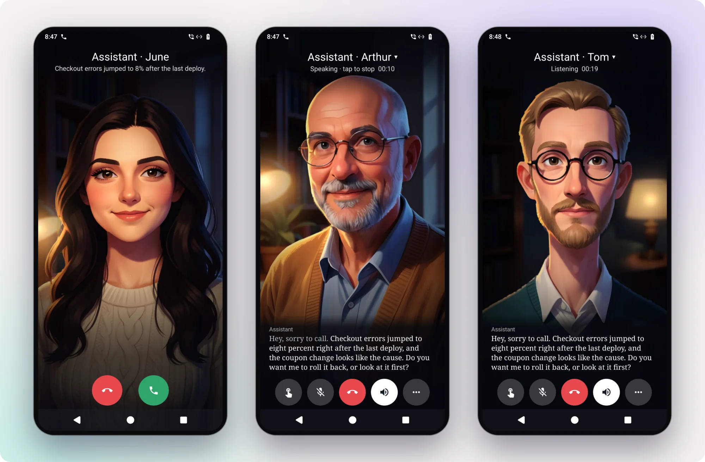

# atc

**Air traffic control for Claude Code.** Every session on every machine, a team of agents working in the background, and an
assistant you can call on the phone. All of it on your own machines, from a browser, a terminal or your phone.

<picture>
  <source media="(prefers-color-scheme: dark)" srcset="docs/img/hero-dark.webp">
  
</picture>

```sh
curl -fsSL https://github.com/zcag/atc/releases/latest/download/install.sh | sh
```

Linux or macOS, with Claude Code signed in. One install serves one user. [More ways to install](#install).

atc is an independent project. It is not affiliated with or endorsed by Anthropic.

## Every session, wherever you are

All your sessions from all your machines in one list, with whatever is waiting on you at the top and a one-line result on each.
Start one in any folder on any machine, and open any of them from a browser, a terminal or your phone.

<picture>
  <source media="(prefers-color-scheme: dark)" srcset="docs/img/board-dark.webp">
  
</picture>

The Android app pushes when a session needs you, and you can approve or answer from the notification. Holding the side key opens
what's waiting, even on the lock screen. Share a link or a screenshot from any app into a session, or see them all on a home
screen widget.

<picture>
  <source media="(prefers-color-scheme: dark)" srcset="docs/img/phones-dark.webp">
  
</picture>

Back at a desk, read what a session did as a transcript: each prompt and reply with the diffs, test results and commits, and search
across the whole thing. Likely next messages are one tap away.

<picture>
  <source media="(prefers-color-scheme: dark)" srcset="docs/img/transcript-dark.webp">
  
</picture>

[Using atc](docs/using.md) · [Android app](docs/android.md) · [Several machines](docs/machines.md)

## An assistant you can call

One conversation that can see everything: your sessions, your agents, what just changed. It answers on a phone call, in
the page and on WhatsApp, and it's the same conversation on all three. Anything urgent can ring you:

```sh
atc call --reason "Checkout errors jumped to 8% after the last deploy"
```

> **Assistant:** Hey, sorry to call. Checkout errors jumped to 8% right after the last deploy, and the coupon change looks like the cause. Do you want me to...
>
> **You:** Wait, was that the only thing in the deploy?
>
> **Assistant:** That and a copy fix. The errors all come from the coupon code.
>
> **You:** Okay, roll it back, and have someone find out why.
>
> **Assistant:** Rolling back now, and I've started a session on the cause. The iOS build on the laptop just finished too, so that's one less thing.
>
> **You:** How many orders did we lose?
>
> **Assistant:** About forty, in eleven minutes. I put the chart on your screen.

<picture>
  <source media="(prefers-color-scheme: dark)" srcset="docs/img/call-ring-dark.webp">
  
</picture>

You can talk over it, and it hears you. It says what it's doing while it works, starts sessions for anything long, and tells you
how they came out after you've hung up. Calling it needs no phone number, and it runs on your machine on 2 CPU cores.
[Calls](docs/calls.md) · [A recorded demo call](docs/img/call-demo.mp4) · [The assistant](docs/assistant.md)

<picture>
  <source media="(prefers-color-scheme: dark)" srcset="docs/img/assistant-dark.webp">
  
</picture>

## A team of agents

An agent is someone you go to for one thing. It keeps its own notes, keeps one long conversation, and wakes up when there's work.

| | Wakes | Does |
|---|---|---|
| **@ops** | when an alert fires | Investigates, fixes the obvious on your machines, and rings you with the rest already worked out |
| **@shopping** | every morning | Researches what's on your list across stores, checks stock and price, leaves a few options to pick from |
| **@email** | when you ask | Sorts your inboxes onto a page you can act on. Marks read what you say, and never sends |
| **@reviewer** | when a pull request has no review | Reads it and writes down what it thinks |
| **@invoice** | every second Friday | Prepares the invoice and the email, and sends on your go |
| **@tracker** | every 3 hours | Sweeps mail, calendar and GitHub into one list of everything open |

We run agents like these every day. You make your own: each is a folder with a page of instructions and a rule for when to wake.

```json
{ "title": "Ops", "check": "./unresolved-alerts.sh", "every": "2m", "prompt": "Look into these." }
```

<picture>
  <source media="(prefers-color-scheme: dark)" srcset="docs/img/agents-dark.webp">
  
</picture>

Between wake-ups they stay out of your way. Ask one something any time with `atc send @shopping "the towel, in grey"`, point a
Grafana alert or a CI webhook at it, or let the assistant read what it knows: "what's open?" gets answered from @tracker's list
without waking anyone. [Agents](docs/presets-and-agents.md)

## Work you can see and step into

A session can put anything in front of you. `atc show report.html` opens it beside the conversation and redraws it as the file
changes: a chart, a comparison, an inbox with working buttons. Every page from every session stays one screen away, on your phone too.

<picture>
  <source media="(prefers-color-scheme: dark)" srcset="docs/img/pages-dark.webp">
  
</picture>

Sessions drive a real browser too. Each gets its own tabs with your logins shared, and you watch them live next to the conversation.
When one hits a login or a captcha, click and type in its tab and it carries on.

<picture>
  <source media="(prefers-color-scheme: dark)" srcset="docs/img/browser-dark.webp">
  
</picture>

[Pages](docs/pages.md) · [A browser for sessions](docs/browser.md)

## Keep it all running

Your 5-hour and weekly limits with a projection of when you'd hit them, and spend by day, model, project and session. Memory and CPU
per session, a week back, including the dev server a finished session left behind. After a reboot, atc brings your sessions back
and tells the interrupted ones to continue.

<table>
<tr>
<td width="50%"><picture>
  <source media="(prefers-color-scheme: dark)" srcset="docs/img/usage-dark.webp">
  
</picture></td>
<td width="50%"><picture>
  <source media="(prefers-color-scheme: dark)" srcset="docs/img/resources-dark.webp">
  
</picture></td>
</tr>
</table>

[Usage and limits](docs/usage.md) · [Resources](docs/resources.md)

## And a lot more

<picture>
  <source media="(prefers-color-scheme: dark)" srcset="docs/img/fleet-dark.webp">
  
</picture>

<table>
<tr>
<td width="50%"><picture>
  <source media="(prefers-color-scheme: dark)" srcset="docs/img/new-dark.webp">
  
</picture><br><b>Start anything.</b> Any folder on any machine, in its own git worktree, from a preset, on Claude, <a href="docs/models.md">a local model or opencode</a>.</td>
<td width="50%"><picture>
  <source media="(prefers-color-scheme: dark)" srcset="docs/img/backlog-dark.webp">
  
</picture><br><b>A backlog.</b> Tasks for later, sessions set aside to resume, and suggestions from your agents. <a href="docs/backlog-and-notify.md">Backlog</a></td>
</tr>
<tr>
<td width="50%"><picture>
  <source media="(prefers-color-scheme: dark)" srcset="docs/img/terminal-dark.webp">
  
</picture><br><b>A terminal UI.</b> <code>atc</code> is the whole list in your terminal, and <code>atc attach</code> opens any session. <a href="docs/using.md#from-a-terminal">From a terminal</a></td>
<td width="50%"><picture>
  <source media="(prefers-color-scheme: dark)" srcset="docs/img/palette-dark.webp">
  
</picture><br><b>A key for everything.</b> <code>/</code> finds any session, page or command.</td>
</tr>
<tr>
<td width="50%"><picture>
  <source media="(prefers-color-scheme: dark)" srcset="docs/img/settings-dark.webp">
  
</picture><br><b>Setup that checks itself.</b> <code>atc doctor</code> and Settings test every feature and give the fix. <a href="docs/settings.md">Settings and doctor</a></td>
<td width="50%"><br><b>Themes.</b> Three, light and dark. <a href="docs/look.md">A new one is one CSS file.</a></td>
</tr>
</table>

- **Sessions that run each other.** `atc mcp` gives any session tools to read, start and message the others. [Sessions driving sessions](docs/sessions.md)
- **WhatsApp.** Text it, send photos and voice notes, and get answers back as voice notes. Let a few other people reach it too, in a conversation of their own. [WhatsApp](docs/whatsapp.md)
- **Notifications from anything.** `atc notify` from a session, with one-tap replies. [Notify](docs/backlog-and-notify.md)
- **Your phone as its home.** Digital assistant role, Quick Settings tile, Android Auto and Bluetooth for calls, QR pairing with per-device revoke. [Android app](docs/android.md)
- **Summaries of every finished turn**, at three lengths, on your plan or your own model. [Summaries](docs/summaries.md)
- **Everything over HTTP and JSON.** The API behind the page is open to your scripts, and CLI commands take `-json`.

The screenshots come from `test/demo/`: atc's real UI on made-up sessions and a fake Claude whose lines on calls are written for the demo, with made-up figures
on the Resources screen. The frames are drawn on. The phones are a debug build of the app on a test device.

## How it works with Claude Code

atc needs Claude Code installed and your own sign-in to it, on the machine atc runs on. It brings no
account and no key of its own.

- It runs the unmodified `claude` binary as the signed-in user: `claude --bg`, `claude attach`,
  `claude agents`, and `claude -p` for summaries.
- It reads what Claude Code keeps on disk for that user: conversation transcripts, its list of
  background sessions, and which folders it trusts.
- It never answers Claude Code's trust prompt or records a yes itself. For a folder not yet trusted,
  atc runs plain `claude` there in its terminal so you answer that prompt yourself. Claude Code writes
  the yes to its own `~/.claude.json`; atc only reads that file, to stop the prompt and start your
  session.
- It reads your plan limits from Claude Code's status line. `atc setup` sets that up
  (`atc limits -tap`), or tells you the line to add if you have your own status line.
- It changes Claude Code's own files in two places: `atc setup`, when you say yes, sets the status
  line and adds atc's MCP server; and atc lists its live sessions in `jobs/pins.json`, which keeps
  Claude Code's background service from retiring them.
- It does not proxy Claude's traffic, modify the `claude` binary, or send your sessions anywhere but
  the devices you connect. It does not read Claude Code's stored credentials.

Everything sessions spend comes out of your own plan or API key, under your agreement with Anthropic.

## Install

```sh
curl -fsSL https://github.com/zcag/atc/releases/latest/download/install.sh | sh
```

This downloads a release for Linux or macOS, checks its checksum, installs `atc` into `~/.local/bin`,
runs it and the assistant as services of your user, and starts `atc setup`.

Or build from source (Go 1.26 or newer):

```sh
go install github.com/zcag/atc@latest
atc service install
```

Then:

1. `atc setup` asks who you are, sets the status line for plan limits, adds atc's tools for your
   sessions and says how to reach atc from other devices. It prints a link to open.
2. `atc doctor` lists what each feature needs, how it stands and the fix.
3. **Settings** in the page (`,`) shows the same list, with a field for each setting.

More in [Install](docs/install.md) and [Security](docs/security.md).

## What you need for what

The core and the assistant work right after install. The rest is optional.

| | What you get | What it takes |
|---|---|---|
| **Core** | The session list, transcripts, pages, agents, backlog, usage, one-line summaries of finished turns | Claude Code. The summaries use a little of your plan; they can use your own model or be off |
| **Assistant** | One conversation that runs the others | On by default, a small second service |
| **Calls** | Talk to it from the browser or the app | `atc voice install`: about 2 GB on disk, 2 CPU cores |
| **WhatsApp and a phone number** | Reach it from WhatsApp or a real number, and let a few other people reach it | Advanced: accounts and numbers of their own, and no promises |

## Docs

[Install](docs/install.md) ·
[Settings and doctor](docs/settings.md) ·
[Security](docs/security.md) ·
[Using atc](docs/using.md) ·
[Several machines](docs/machines.md) ·
[Android app](docs/android.md) ·
[Presets and agents](docs/presets-and-agents.md) ·
[Other models and opencode](docs/models.md) ·
[Pages](docs/pages.md) ·
[Backlog and notify](docs/backlog-and-notify.md) ·
[A browser for sessions](docs/browser.md) ·
[Outputs](docs/outputs.md) ·
[Summaries](docs/summaries.md) ·
[Usage and limits](docs/usage.md) ·
[Resources](docs/resources.md) ·
[Sessions driving sessions](docs/sessions.md) ·
[The assistant and its channels](docs/assistant.md) ·
[Calls](docs/calls.md) ·
[WhatsApp and speech services](docs/whatsapp.md) ·
[Look and themes](docs/look.md)

## License

MIT, see [LICENSE](LICENSE). What atc bundles and depends on is listed in
[THIRD_PARTY.md](THIRD_PARTY.md).
